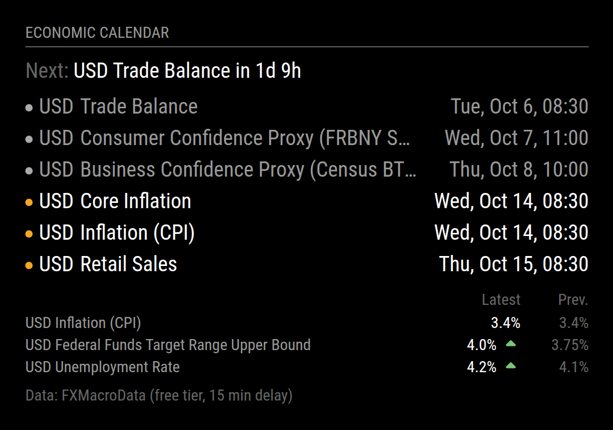

# MMM-FXMacroData

A [MagicMirror²](https://magicmirror.builders/) module that shows the upcoming macroeconomic release calendar (CPI, central-bank decisions, jobs reports and so on) for the currencies you care about, with a countdown to the next release and a small table of the latest figures.



Data comes from the [FXMacroData](https://fxmacrodata.com/?utm_source=github&utm_medium=referral&utm_campaign=MMM-FXMacroData&utm_content=readme) REST API, which collects release dates and values from official sources such as statistics offices and central banks.

## Features

- Upcoming releases for one or more currencies, merged and sorted by time, shown in your local time zone
- High-importance releases highlighted, with a filter to hide low-importance ones
- Countdown to the next release
- Optional "latest values" table (default: inflation, policy rate, unemployment) with the previous value and direction of change
- No dependencies to install. All requests are made by the node helper using the built-in `fetch` of Node.js 18+

## API access and limits

The module uses two public endpoints:

- `GET https://api.fxmacrodata.com/v1/calendar/{currency}`
- `GET https://api.fxmacrodata.com/v1/announcements/{currency}/{indicator}?limit=1`

**USD works without an API key.** Keyless data is delayed by 15 minutes and limited to the last 90 days, so a quarterly series such as GDP can show "needs key" between releases.

**Every other currency needs an API key** (AUD, BRL, CAD, CHF, CNH, CNY, DKK, EUR, GBP, HUF, ILS, JPY, KRW, MYR, NGN, NOK, NZD, PEN, SEK, THB, TWD). Without one the module shows a short message for that currency instead of failing.

The module refreshes every 15 minutes by default (5 minutes at the most), runs one request at a time per currency and shares results between browser windows, so a mirror makes only a handful of requests per hour.

## Install

```bash
cd ~/MagicMirror/modules
git clone https://github.com/fxmacrodata/MMM-FXMacroData
```

There is nothing else to install.

## Update

```bash
cd ~/MagicMirror/modules/MMM-FXMacroData
git pull
```

## Configuration

Add the module to the `modules` array in `config/config.js`. This minimal example works without an API key:

```js
{
  module: "MMM-FXMacroData",
  position: "top_left",
  header: "Economic Calendar",
  config: {
    currencies: ["USD"]
  }
},
```

A fuller example with several currencies and an API key:

```js
{
  module: "MMM-FXMacroData",
  position: "top_left",
  header: "Economic Calendar",
  config: {
    apiKey: "${SECRET_FXMACRODATA_API_KEY}",
    currencies: ["USD", "EUR", "GBP", "JPY"],
    maxItems: 8,
    minImportance: "high",
    indicators: ["inflation", "policy_rate"]
  }
},
```

### Options

| Option                | Default                                       | Description                                                                                                       |
| --------------------- | --------------------------------------------- | ----------------------------------------------------------------------------------------------------------------- |
| `currencies`          | `["USD"]`                                     | Currencies to show. Non-USD currencies need `apiKey`.                                                             |
| `apiKey`              | `""`                                          | Your FXMacroData API key. Optional for USD. See [Keeping the API key private](#keeping-the-api-key-private).      |
| `maxItems`            | `6`                                           | Number of upcoming releases to list (all currencies together).                                                    |
| `minImportance`       | `"medium"`                                    | Hide releases below this importance: `"low"` (show everything), `"medium"` or `"high"`.                           |
| `lookaheadDays`       | `14`                                          | Only list releases within this many days. `0` for no limit.                                                       |
| `showCountdown`       | `true`                                        | Show the "Next: … in 2d 4h" line above the list.                                                                  |
| `showCurrency`        | `true`                                        | Show the currency code next to each release.                                                                      |
| `showReferencePeriod` | `false`                                       | Show the period a release covers, e.g. "September 2026", when the calendar provides it.                           |
| `showLatest`          | `true`                                        | Show the latest values table.                                                                                     |
| `indicators`          | `["inflation", "policy_rate", "unemployment"]` | Indicators for the latest values table. Other examples: `core_inflation`, `gdp`, `non_farm_payrolls`, `retail_sales`. |
| `showFooter`          | `true`                                        | Show the data source line (and the 15 minute delay note when no key is set).                                      |
| `updateInterval`      | `900000` (15 min)                             | How often to refresh, in milliseconds. Values below 5 minutes are raised to 5 minutes.                            |
| `animationSpeed`      | `1000`                                        | Fade time when the content changes, in milliseconds.                                                              |

Release times use your mirror's `language` and `timeFormat` settings and the time zone of the device showing the mirror.

The indicator names each currency supports are listed in the API's OpenAPI document at `https://api.fxmacrodata.com/openapi.json`.

### Keeping the API key private

The key is only used by the node helper on the MagicMirror² server and is sent to the API as an `X-API-Key` header, never in a URL. The browser part of the module never sends or receives it.

MagicMirror² does send module config to the browser, though, so do not paste the key into `config.js` as plain text. Use one of these instead:

1. **Secrets (MagicMirror² v2.35.0 or newer).** Put the key in `config/config.env`:

   ```bash
   SECRET_FXMACRODATA_API_KEY=your-key-here
   ```

   and set `apiKey: "${SECRET_FXMACRODATA_API_KEY}"` as in the example above. The browser only ever sees a placeholder.

2. **Environment variable.** Leave `apiKey` empty and start MagicMirror² with `FXMACRODATA_API_KEY` set. The node helper picks it up when no `apiKey` is configured.

## Development

The data-shaping functions and the node helper have unit tests that use only the Node.js built-in test runner:

```bash
cd ~/MagicMirror/modules/MMM-FXMacroData
node --test
```

## Status

Actively maintained. Bug reports and pull requests are welcome in the [issue tracker](https://github.com/fxmacrodata/MMM-FXMacroData/issues).

## License

MIT, see [LICENSE](LICENSE).
